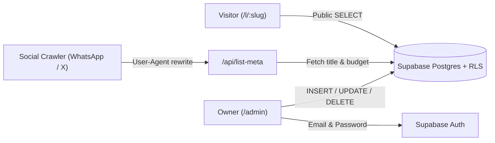

<div align="center">


# Event Wishlists

**Personal gift wishlists by event — built with React, TypeScript, Vite & Supabase.**


</div>

---

## Routes

| Route | Access | Purpose | Highlights |
| :--- | :--- | :--- | :--- |
| `/` | Public | Neutral landing | Hides active events; discreet link to `/admin` |
| `/l/:slug` | Public | Shareable wishlist | Budget cap, countdown, price sort/filter, Quick Look, store tags |
| `/admin` | Owner only | Private studio | Email & password auth, event & item CRUD, manual reorder, QR SVG export |

> **Intentional scope:** no gift reservations, no store URL scraping, and no visitor accounts.

---

## Architecture



---

## Stack

| Layer | Choice | Why |
| :--- | :--- | :--- |
| **UI** | React 19 + native CSS | Apple-inspired translucent UI, light/dark mode, zero heavy UI libs |
| **Routing** | `react-router-dom` v7 | Clean SPA routes with Vercel & Cloudflare fallbacks |
| **Backend** | Supabase (`@supabase/supabase-js`) | Postgres + Email Auth + Row Level Security (`auth.uid() = user_id`) |
| **QR & Previews** | `qrcode-generator` + `/api/list-meta` | Client-side SVG QR codes & dynamic Open Graph cards on share |

---

## Quick Start

### 1. Supabase Setup

1. Create a project in [Supabase](https://supabase.com/).
2. Run [`supabase/schema.sql`](supabase/schema.sql) in **SQL Editor**.
3. Enable **Email** in **Authentication → Providers** (turn off **Confirm email** if you want instant signup without custom SMTP).

### 2. Environment Variables

```bash
cp .env.example .env
```

```env
VITE_SUPABASE_URL=https://your-project.supabase.co
VITE_SUPABASE_ANON_KEY=your-public-anon-key
```

> Use only the public `anon` / `publishable` key (`VITE_*` variables are bundled for the browser).

### 3. Run Locally

```bash
npm install
npm start
```

| Command | Action |
| :--- | :--- |
| `npm start` | Start Vite dev server |
| `npm test` | Run unit tests (`src/lib/format.test.ts`) |
| `npm run build` | Type-check (`tsc --noEmit`) and build `dist/` |

---

## Deployment

| Platform | Config | Behavior |
| :--- | :--- | :--- |
| **Vercel** | [`vercel.json`](vercel.json) + [`api/list-meta.js`](api/list-meta.js) | SPA fallback + dynamic Open Graph metadata for `/l/:slug` |
| **Cloudflare Pages** | [`public/_redirects`](public/_redirects) | SPA fallback (`/* /index.html 200`) |
